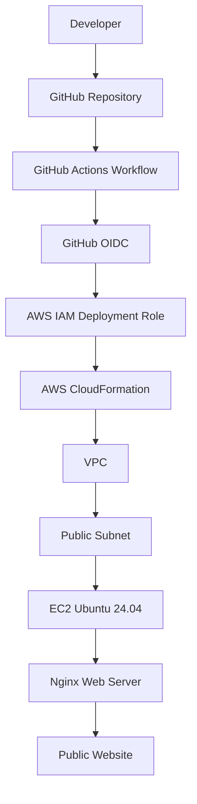
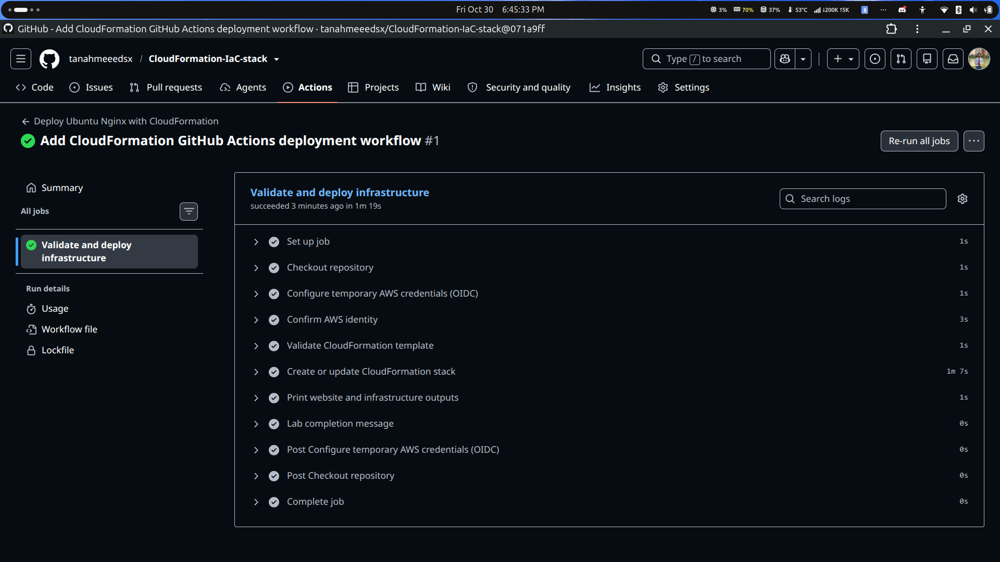
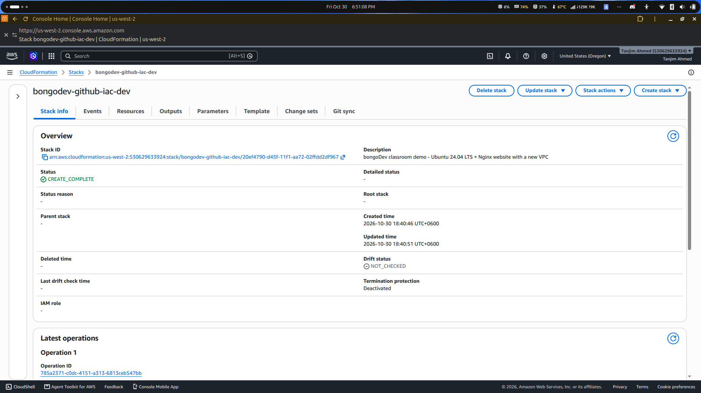
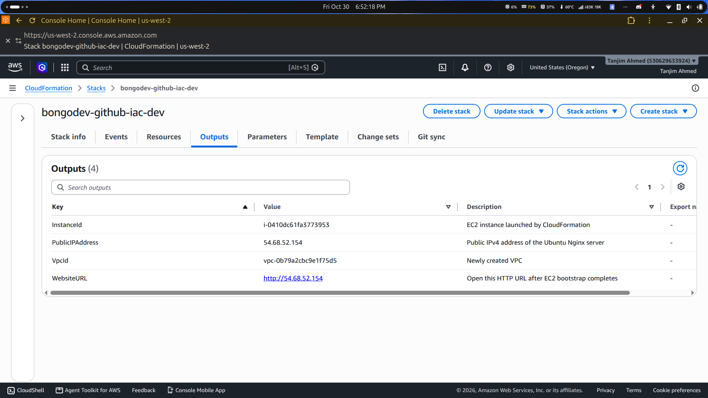
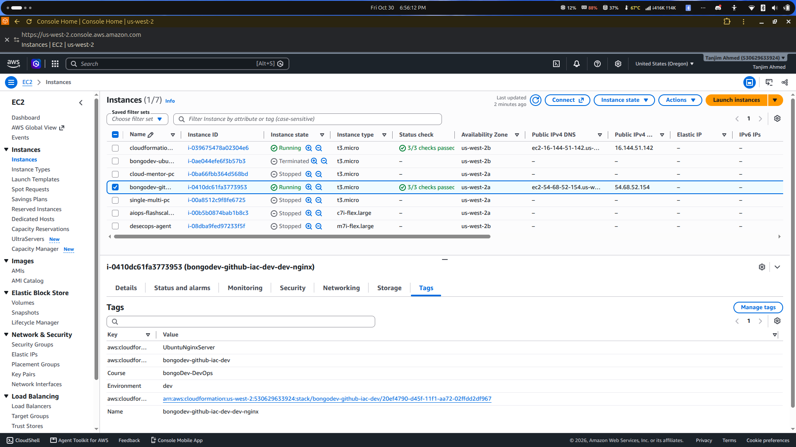
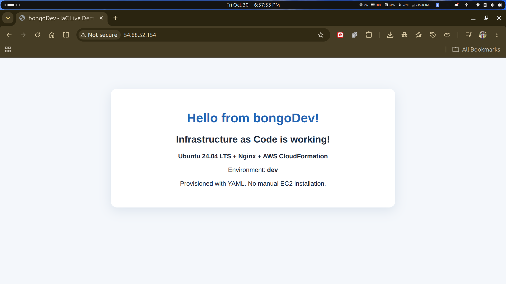
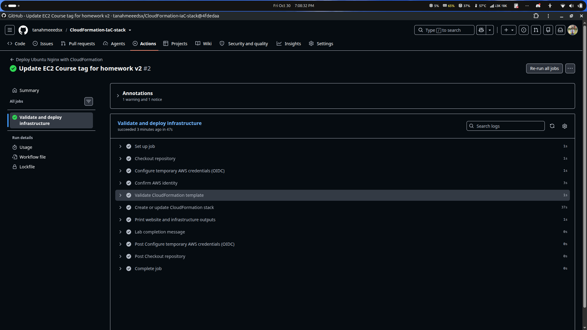
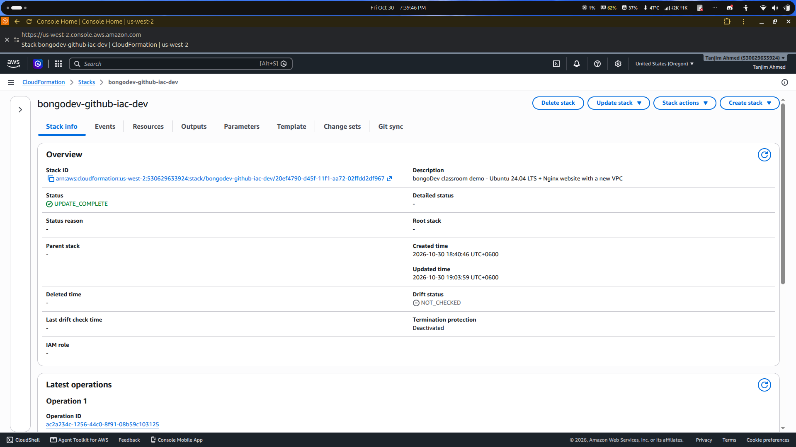
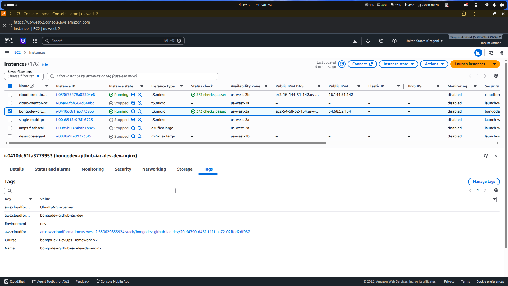

<h1 align="center">CloudFormation IaC Stack</h1>

<p align="center">
  
  
  
  
  
</p>

<p align="center">
  <b>Infrastructure as Code with AWS CloudFormation and GitHub Actions</b><br>
  Automated provisioning and deployment of an Ubuntu-based Nginx web server using GitHub Actions and AWS OIDC authentication.
</p>

<p align="center">
  <a href="https://github.com/tanahmeeedsx/CloudFormation-IaC-stack">Repository</a> ·
  <a href="#architecture">Architecture</a> ·
  <a href="#screenshots">Screenshots</a> ·
  <a href="#deployment">Deployment</a>
</p>

---

## Overview

This project demonstrates how to provision AWS infrastructure using **Infrastructure as Code (IaC)** with AWS CloudFormation and automate deployments through GitHub Actions.

The infrastructure creates a custom VPC, public subnet, Internet Gateway, route table, security group, and an Ubuntu 24.04 EC2 instance running Nginx.

GitHub Actions authenticates with AWS through **OpenID Connect (OIDC)**, allowing the workflow to deploy CloudFormation changes without storing long-lived AWS access keys in GitHub Secrets.

The project also demonstrates how CloudFormation handles infrastructure updates while maintaining the existing EC2 instance.

## Key Features

- Infrastructure provisioning using AWS CloudFormation.
- Custom VPC and public subnet configuration.
- Ubuntu 24.04 LTS EC2 instance with Nginx.
- Automated deployment using GitHub Actions.
- Secure AWS authentication using GitHub OIDC.
- IAM role-based deployment permissions.
- CloudFormation parameters, outputs, and resource tags.
- Automated infrastructure updates through Git pushes.
- IMDSv2 requirement enabled for the EC2 instance.

## Tech Stack

| Technology | Purpose |
|---|---|
| AWS CloudFormation | Infrastructure as Code |
| Amazon EC2 | Virtual server hosting |
| Amazon VPC | Network isolation |
| AWS IAM | Roles and permissions |
| AWS OIDC | Secure GitHub-to-AWS authentication |
| GitHub Actions | CI/CD automation |
| Ubuntu 24.04 LTS | Server operating system |
| Nginx | Web server |
| AWS CLI | Infrastructure validation and management |
| YAML | CloudFormation and workflow configuration |

## Architecture

The deployment follows this workflow:



### Infrastructure Components

| Component | Configuration |
|---|---|
| VPC | `10.42.0.0/16` |
| Public Subnet | `10.42.1.0/24` |
| EC2 Instance | `t3.micro` |
| Operating System | Ubuntu 24.04 LTS |
| Web Server | Nginx |
| HTTP Access | TCP port 80 |
| SSH Access | Not enabled in the security group |
| Instance Metadata | IMDSv2 required |
| Default Environment | `dev` |

## Automated Deployment Workflow

The GitHub Actions workflow is located at:

`.github/workflows/deploy.yml`

It runs when changes are pushed to the `main` branch affecting:

- `cloudformation.yaml`
- `.github/workflows/deploy.yml`

It can also be started manually using `workflow_dispatch`.

### Deployment Process

1. GitHub Actions checks out the repository.
2. GitHub requests an OIDC identity token.
3. AWS STS exchanges the token for temporary credentials.
4. The workflow assumes the configured IAM deployment role.
5. AWS CloudFormation validates the template.
6. CloudFormation creates or updates the infrastructure.
7. The workflow displays the stack outputs.

### Why OIDC?

Instead of storing permanent AWS access keys in GitHub, this project uses OIDC federation.

This provides temporary AWS credentials through an IAM role and limits access to the trusted GitHub repository and branch.

## Repository Structure

```text
CloudFormation-IaC-stack/
│
├── .github/
│   └── workflows/
│       └── deploy.yml
│
├── docs/
│   ├── homework-instructions.md
│   └── student-submission-checklist.md
│
├── iam/
│   ├── deployment-policy-lab.json
│   ├── trust-policy-legacy-repos.json
│   └── trust-policy-new-repos-2026.json
│
├── screenshots/
│   ├── 01-github-actions-create.png
│   ├── 02-cloudformation-create-complete.png
│   ├── 03-cloudformation-outputs.png
│   ├── 04-ec2-instance.png
│   ├── 05-nginx-website.png
│   ├── 06-github-actions-update.png
│   ├── 07-cloudformation-update-complete.png
│   └── 08-ec2-updated-tag.png
│
├── cloudformation.yaml
├── terminal-command.txt
└── README.md
```

## Deployment

### Prerequisites

- AWS account
- AWS CLI installed and configured
- Git and GitHub account
- An AWS IAM OIDC provider for GitHub Actions
- An IAM deployment role with the required permissions

### 1. Clone the Repository

```bash
git clone https://github.com/tanahmeeedsx/CloudFormation-IaC-stack.git
cd CloudFormation-IaC-stack
```

### 2. Validate the CloudFormation Template

```bash
aws cloudformation validate-template \
  --template-body file://cloudformation.yaml \
  --region us-west-2
```

### 3. Configure GitHub Actions Variables

Add these repository-level Actions variables:

| Variable | Value |
|---|---|
| `AWS_REGION` | `us-west-2` |
| `AWS_ROLE_ARN` | Your AWS deployment IAM role ARN |

The workflow uses GitHub OIDC to assume this role. Do not store AWS access keys in the repository.

### 4. Deploy Through GitHub Actions

Push a change to the CloudFormation template or workflow file:

```bash
git add cloudformation.yaml
git commit -m "Update CloudFormation infrastructure"
git push origin main
```

GitHub Actions will automatically validate and deploy the CloudFormation stack.

### 5. Check Stack Outputs

The deployment workflow displays the stack outputs, including:

- Website URL
- EC2 Instance ID
- Public IP address
- VPC ID

You can also retrieve them using:

```bash
aws cloudformation describe-stacks \
  --stack-name bongodev-github-iac-dev \
  --region us-west-2 \
  --query "Stacks[0].Outputs"
```

## Infrastructure Update Test

After the initial deployment, the EC2 instance's `Course` tag was updated in `cloudformation.yaml`.

**Previous tag:**

```yaml
- Key: Course
  Value: bongoDev-DevOps
```

**Updated tag:**

```yaml
- Key: Course
  Value: bongoDev-DevOps-Homework-V2
```

After pushing the change, GitHub Actions successfully executed the CloudFormation update.

The stack reached `UPDATE_COMPLETE`, and the EC2 instance retained its identity while its tag was updated.

This demonstrates how CloudFormation manages infrastructure changes through a repeatable deployment workflow.

## Screenshots

The following screenshots document the deployment and update process.

### 1. Initial GitHub Actions Deployment



### 2. CloudFormation Stack Creation



### 3. CloudFormation Outputs



### 4. EC2 Instance



### 5. Nginx Website



### 6. GitHub Actions Infrastructure Update



### 7. CloudFormation Update Complete



### 8. Updated EC2 Tag



## Challenges and Solutions

| Challenge | Solution |
|---|---|
| Secure AWS authentication from GitHub Actions | Configured GitHub OIDC federation with an AWS IAM role |
| Avoiding permanent AWS credentials in GitHub | Used temporary credentials through AWS STS |
| Deploying infrastructure consistently | Used CloudFormation as the infrastructure definition |
| Making the web server publicly accessible | Configured a public subnet, Internet Gateway, route table, and HTTP security group rule |
| Updating infrastructure safely | Updated the CloudFormation template and deployed through GitHub Actions |
| Restricting server access | Allowed HTTP traffic without opening SSH access |

## What I Learned

- Understanding Infrastructure as Code with AWS CloudFormation.
- Creating and configuring VPC networking resources.
- Provisioning EC2 instances using CloudFormation.
- Installing and configuring Nginx through EC2 UserData.
- Building GitHub Actions deployment workflows.
- Implementing AWS OIDC federation.
- Configuring IAM trust policies and deployment permissions.
- Managing CloudFormation stack creation and updates.
- Understanding infrastructure outputs, events, and resource dependencies.

## Future Improvements

- Add CloudFormation linting and security checks.
- Introduce separate development and production environments.
- Store deployment artifacts and logs centrally.
- Add monitoring and alerting using Amazon CloudWatch.
- Configure HTTPS with a domain name and TLS certificate.
- Improve IAM permissions using resource-level restrictions where supported.
- Add automated infrastructure testing before deployment.

## Cleanup

To avoid unnecessary AWS charges, delete the CloudFormation stack when the infrastructure is no longer needed.

**Delete the project stack only:**

```bash
aws cloudformation delete-stack \
  --stack-name bongodev-github-iac-dev \
  --region us-west-2
```

Wait for deletion to finish:

```bash
aws cloudformation wait stack-delete-complete \
  --stack-name bongodev-github-iac-dev \
  --region us-west-2
```

This deletes the resources managed by this stack, including its EC2 instance and VPC resources.

The separately created IAM deployment role and its policy are not stack resources in this project. Review and remove them separately if they are no longer needed. Do not delete a shared GitHub OIDC provider that other projects may use.

## Author

**Tanjim Ahmed Tomal**

Computer Engineering Graduate | DevOps & Cloud Engineering

- GitHub: [@tanahmeeedsx](https://github.com/tanahmeeedsx)

---

<p align="center">
  Built with AWS CloudFormation, GitHub Actions, and a focus on Infrastructure as Code.
</p>
